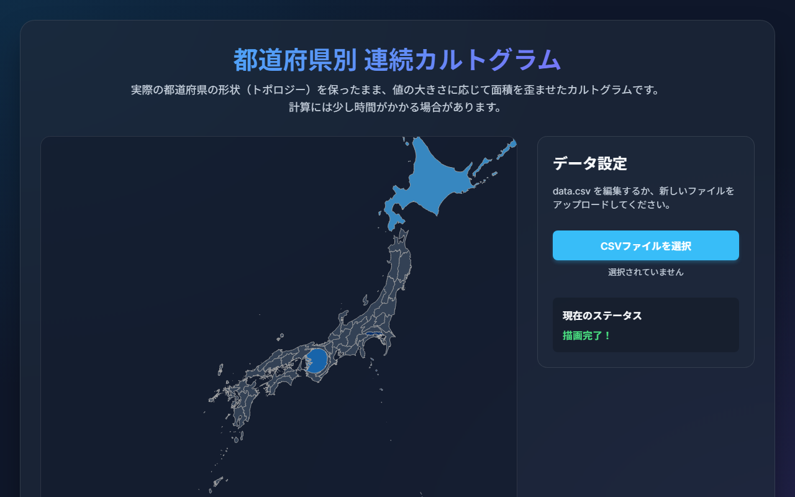

# 都道府県別 連続面積カルトグラム (Prefecture Continuous Area Cartogram)

TopoJSON 形式の日本地図データを入力し、都道府県ごとの数値データに比例して隣接関係（トポロジー）を保ったまま連続的に面積変形・配色を行うブラウザ完結型のインタラクティブ可視化ツールです。

- **ライブデモ（GitHub Pages）**: https://sp9r.github.io/prefecture-cartogram/



## 技術構成・実装ポイント

- **技術スタック**: `JavaScript (ES6+)` / `D3.js v7` / `cartogram-chart` / `TopoJSON` / `HTML5 / CSS3`
- **隣接トポロジー保持変形**: `japan.topojson` 上の都道府県境界を保ったまま、`d3.geoMercator` 投影と `cartogram-chart` による連続面積カルトグラムを計算・描画します。
- **クライアントサイド CSV 読込**: `FileReader` と `d3.csvParse` によりブラウザ上で `prefecture,value` 形式の任意 CSV を検証・読み込みでき、サーバーへデータを送信せずに即座にカラースケール（`d3.interpolateBlues`）と地図を再描画します。
- **数値外れ値対策**: 値 `0` または未設定の都道府県でも幾何計算が破綻しないよう下限値ガード（`0.1`）を入れています。

## ファイル構成

- `index.html` / `style.css` / `script.js`: UI・CSVパーサー・カルトグラム描画ロジック
- `japan.topojson`: 日本全国の都道府県 TopoJSON データ
- `京大_合格者数.csv` / `阪大_合格者数.csv`: サンプルデータセット

## ローカルでの起動方法

ブラウザの `fetch` でローカルの `japan.topojson` を読み込むため、簡易HTTPサーバー経由で開きます。

```bash
git clone https://github.com/sp9r/prefecture-cartogram.git
cd prefecture-cartogram
python -m http.server 8000
```

ブラウザで `http://localhost:8000/` を開き、画面右側のファイル選択からサンプル CSV または任意の `prefecture,value` CSV を読み込んで利用できます。

## ライセンス

MIT License（[LICENSE](./LICENSE)）
